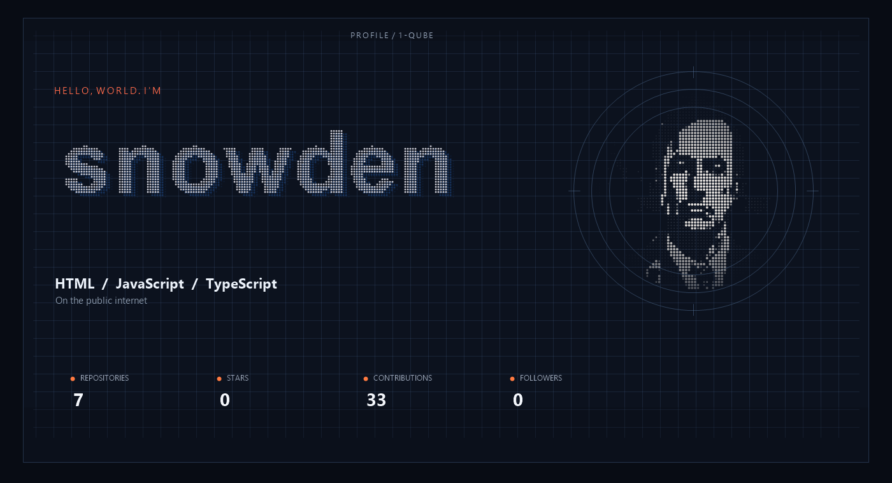
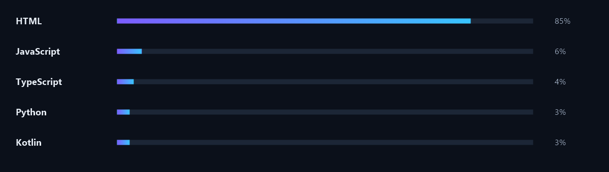

  

  <strong>Frontend / full-stack student building in public</strong> 
  AI tools, research apps, and small sites that run in the browser.  
  <a href="https://1-qube.github.io/1-Qube/">Interactive profile</a>
  ·
  <a href="https://github.com/1-Qube">GitHub</a>

  The interactive site is served from <code>/docs</code>. Enable GitHub Pages (branch <code>main</code>, folder <code>/docs</code>) and it will be live at <a href="https://1-qube.github.io/1-Qube/">https://1-qube.github.io/1-Qube/</a>.

## Focus

Student shipping in public. The work is document readers, idea stress-tests, local company research, and plain browser experiments.

| Area | Now |
| --- | --- |
| AI tools | Document reading, idea stress-tests |
| Research | One company at a time, starting in Taraz |
| Web | Physics lab, plain HTML / CSS / JS |
| Mobile | A small Kotlin greeting app |

## Featured projects

| Project | What it is | Stack |
| --- | --- | --- |
| [SynAi](https://github.com/1-Qube/SynAi) | AI-powered document reader and analyzer | TypeScript |
| [innovative-ai](https://github.com/1-Qube/innovative-ai) | SYNA startup idea stress lab | HTML |
| [trendpilot](https://github.com/1-Qube/trendpilot) | Live research agent for local companies in Taraz | HTML |
| [trendpilot_](https://github.com/1-Qube/trendpilot_) | Research app for one company at a time | HTML |
| [mathweb](https://github.com/1-Qube/mathweb) | Browser physics lab: lessons, calculators, formulas, quiz | HTML · JavaScript |
| [Have-a-lucky-day-](https://github.com/1-Qube/Have-a-lucky-day-) | A small app that wishes you a good day | Kotlin |

## Stack in public

  

## Activity

  
  

  

## Contact

Open to useful builds, ambitious products, and teams who care about the work.

  <a href="https://github.com/1-Qube?tab=repositories">Repositories</a>
  ·
  <a href="https://1-qube.github.io/1-Qube/">Interactive profile</a>

